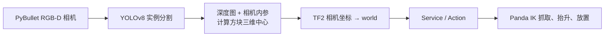
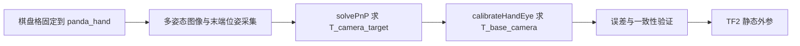
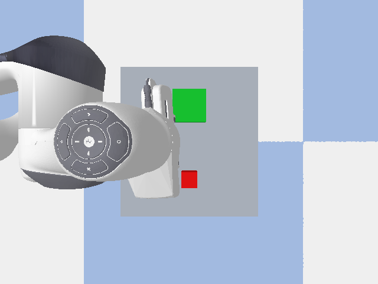
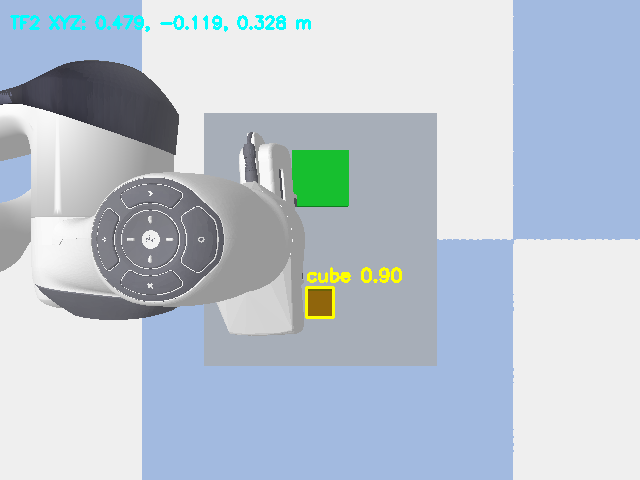
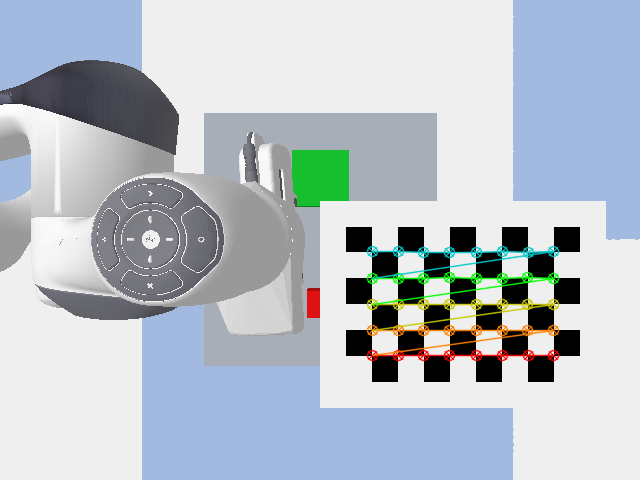
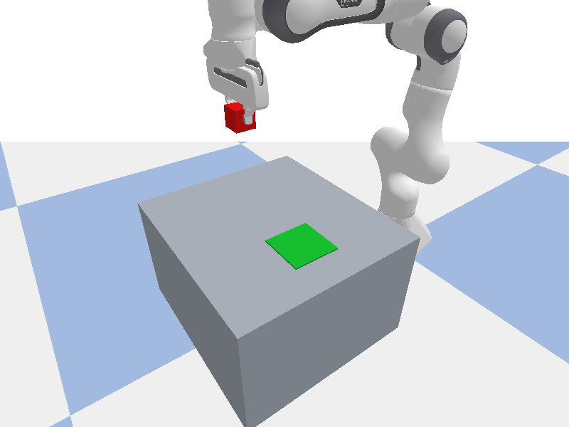
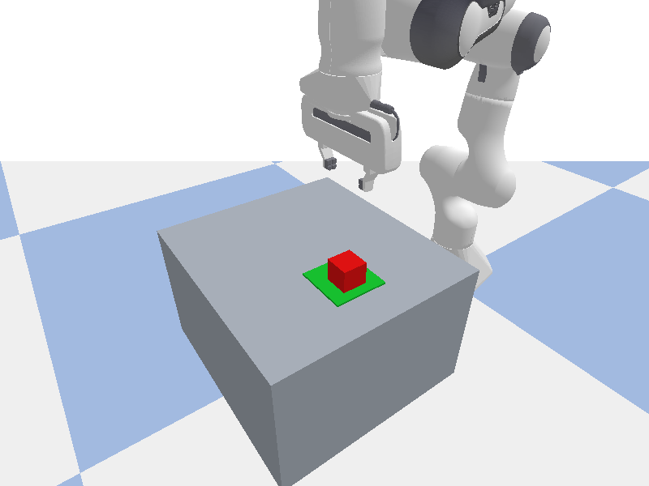

# ROS 2 Panda 视觉引导抓取与 Eye-to-Hand 手眼标定

在 **Ubuntu 24.04 + ROS 2 Jazzy** 中，使用 PyBullet Panda、固定 RGB-D 相机和 YOLOv8 实例分割完成红色方块的识别、三维定位、抓取与放置。项目用 18 组末端棋盘格姿态求解 Eye-to-Hand 外参，并通过 TF2 将视觉目标转换到机器人世界坐标系。**所有抓取均为 PyBullet 仿真，不涉及真实机械臂。**

> 已验证：18 组有效标定样本；相机平移误差 **3.666 mm**、旋转误差 **0.153°**；PnP 平均重投影 RMS **0.164 px**。使用标定外参通过原有 Launch 和 Service 完成一次视觉抓取。

## 核心功能

| 模块 | 实现内容 |
|---|---|
| 视觉感知 | YOLOv8 实例分割，结合 RGB、深度图和相机内参估计方块中心；不以方块仿真真值作为定位输入。 |
| 坐标变换 | `camera_optical_frame → panda_link0 → world`，由 TF2 发布和查询相机外参及目标坐标。 |
| 手眼标定 | 末端安装 9×6 方格标定板，采集 18 组姿态；`solvePnP` + `calibrateHandEye` 求解固定相机外参。 |
| 抓取执行 | Panda 逆运动学、关节轨迹、双指接触与抬升检查，最后放置到绿色区域。 |
| ROS 2 通信 | RGB-D Topic、抓取 Service/Action；两个 C++ 节点可独立订阅目标和 TF2 数据。 |

## 系统流程





正式抓取链路只有一条：`panda_grasp.launch.py` 启动 `sim_camera_node.py` 与 `yolo_node.py`，感知节点发布 `/grasp/target_point`，仿真节点收到 Service 或 Action 请求后调用 `PandaGraspController`。标定脚本独立运行。

## Eye-to-Hand 手眼标定

相机固定在 Panda 外部，棋盘格随 `panda_hand` 运动。棋盘格为 **9×6 方格、8×5 内角点**，实际方格边长 **0.02 m**。采集程序保存每张原图、40 个角点、相机内参和对应的末端位姿。求解时先用 `solvePnP` 得到 `T_camera_target`，再将 `T_base_hand` 取逆后传入 OpenCV 的 `calibrateHandEye`，得到 `T_base_camera`。

`T_base_camera` 表示将相机光学坐标系中的点变换到 `panda_link0`。它已包含 PyBullet 基座惯性框架与 `panda_link0` 之间的 **0.05 m** 修正，TF2 发布时不再重复修正。仿真真值仅在求解完成后用于误差验证，不作为标定输入。

| 标定结果 | 实测值 |
|---|---:|
| 有效姿态 / 每组内角点 | 18 组 / 40 个 |
| PnP 平均重投影 RMS | 0.164 px |
| 相对仿真真值的平移误差 | 3.666 mm |
| 相对仿真真值的旋转误差 | 0.153° |
| `T_base_camera` 平移 `(x, y, z)` | `(0.478048, -0.001755, 1.122560)` m |

完整数据和矩阵见 [`dataset.json`](outputs/calibration_collect/full_18/dataset.json)、[`handeye_report.json`](outputs/calibration_collect/full_18/handeye_report.json)；Launch 默认读取同目录的 [`handeye_result.npz`](outputs/calibration_collect/full_18/handeye_result.npz)。`groundtruth` 模式使用原仿真相机位姿，`calibrated` 模式使用该 NPZ 外参。两种模式保持同一棵 TF2 树，标定文件缺失或坐标系不匹配时不会自动回退。

学习与复现实验的入口依次为 `calibration_demo.py`、`calibration_collect.py`、`calibration_solve.py`。在工作区根目录、已加载下文环境后，可运行：

```bash
python -m panda_grasp_ros.calibration_demo
python -m panda_grasp_ros.calibration_collect --target-samples 18 \
  --output-dir outputs/calibration_collect/reproduce_18
python -m panda_grasp_ros.calibration_solve \
  --dataset outputs/calibration_collect/reproduce_18/dataset.json
```

上述命令将新数据写入 `reproduce_18/`，不会覆盖随项目保留的 `full_18/`。

## 实验结果与图片

以下图片均来自本工作区的 PyBullet 仿真输出。YOLO 图由原 Launch 的 `calibrated` 模式发布的 `/yolo/annotated_image` 保存；棋盘格图来自 18 组标定数据；动作阶段图用于展示 Panda 仿真过程。

| 仿真场景 | YOLOv8 + RGB-D + TF2 视觉定位 |
|---|---|
|  |  |

| 8×5 内角点检测 | Panda 抬升方块 |
|---|---|
|  |  |



本次通过原 Launch 运行的 **单次标定外参抓取**：YOLO/TF2 目标坐标约 `(0.4786, -0.1192, 0.3275) m`，视觉定位误差 **3.01 mm**，双指接触点数量 **[1, 1]**，Service 返回成功，最终放置 XY 误差 **10.6 mm**。

## 环境与运行

准备 **Ubuntu 24.04、ROS 2 Jazzy、Python 3.12、colcon**，并将训练好的 YOLOv8 方块实例分割权重放到 `models/cube_best.pt`。权重不随仓库提交。首次配置和构建：

```bash
source /opt/ros/jazzy/setup.bash
cd ~/panda_grasp_ws
python3 -m venv --system-site-packages .venv
source .venv/bin/activate
python -m pip install -r src/panda_grasp_ros/requirements-vision.txt
python -m colcon build --symlink-install
source install/setup.bash
```

已有 `.venv` 时跳过创建虚拟环境。每个新终端都需执行：

```bash
source /opt/ros/jazzy/setup.bash
cd ~/panda_grasp_ws
source .venv/bin/activate
source install/setup.bash
```

启动原有 Launch。`gui:=true` 显示 PyBullet 窗口；无图形桌面时改为 `gui:=false`。

```bash
# 原运行方式，默认 groundtruth 外参
ros2 launch panda_grasp_ros panda_grasp.launch.py gui:=true

# 使用 Eye-to-Hand 标定外参
ros2 launch panda_grasp_ros panda_grasp.launch.py gui:=true extrinsic_mode:=calibrated
```

两条 Launch 命令按需选择其一。默认标定文件路径是 `~/panda_grasp_ws/outputs/calibration_collect/full_18/handeye_result.npz`；更换文件时使用 `calibration_file:=/绝对路径/handeye_result.npz`，并将对应的 `handeye_report.json` 放在同一目录。

在**另一个已加载环境的终端**确认视觉目标后，选择 Service 或 Action 发起一次抓取：

```bash
ros2 topic echo /grasp/target_point --once
ros2 service call /grasp/execute std_srvs/srv/Trigger '{}'
# 或者：ros2 action send_goal /grasp/task panda_grasp_interfaces/action/ExecuteGrasp '{start: true}' --feedback
```

每次启动仿真只允许一次抓取尝试；再次抓取需重启 Launch。不要在同一次启动中依次调用 Service 和 Action。

## 项目结构

```text
panda_grasp_ws/
├── README.md
├── LICENSE                       # 项目代码 Apache-2.0
├── assets/                         # README 使用的真实仿真图片
├── models/cube_best.pt             # 用户自备权重，不提交
├── outputs/
│   ├── calibration/                # 单次棋盘格安装与检测演示
│   ├── calibration_collect/full_18/# 18 组原图、角点、位姿和手眼结果
│   └── grasp_visual/               # Panda 动作阶段截图
└── src/
    ├── panda_grasp_ros/           # PyBullet 场景、相机、TF2、抓取控制、标定
    │   ├── launch/panda_grasp.launch.py
    │   └── panda_grasp_ros/
    │       ├── sim_camera_node.py
    │       ├── grasp_controller.py
    │       ├── sim_rgbd_camera.py
    │       ├── tf_utils.py
    │       ├── calibration_demo.py
    │       ├── calibration_collect.py
    │       └── calibration_solve.py
    ├── panda_grasp_perception/    # YOLO 节点与 RGB-D 几何定位
    ├── panda_grasp_interfaces/    # ExecuteGrasp.action
    └── panda_grasp_cpp/           # 可选 C++ 目标订阅与 TF2 验证节点
```

## ROS 2 接口与注意事项

| 接口 | 类型 / 作用 |
|---|---|
| `/camera/color/image_raw`、`/camera/depth/image_raw`、`/camera/color/camera_info` | 同时间戳的 RGB、米单位深度与内参。 |
| `/yolo/annotated_image`、`/yolo/cube_mask` | 检测标注图和实例掩膜。 |
| `/grasp/target_point_camera`、`/grasp/target_point` | 相机光学坐标与 `world` 坐标中的目标中心。 |
| `/grasp/execute` | `std_srvs/srv/Trigger`，执行一次抓取。 |
| `/grasp/task` | `panda_grasp_interfaces/action/ExecuteGrasp`，带阶段反馈。 |
| `/tf_static` | `world → panda_link0 → camera_optical_frame`；仅 `sim_camera` 发布相机静态 TF。 |

Launch 参数：`gui`（默认 `false`）、`cube_x`（`0.48` m）、`cube_y`（`-0.12` m）、`camera_hz`（`2.0` Hz）、`extrinsic_mode`（`groundtruth` / `calibrated`，默认前者）、`calibration_file`（NPZ 路径）。相机光学坐标约定为 X 向右、Y 向下、Z 向前。使用 `ros2 run tf2_ros tf2_echo panda_link0 camera_optical_frame` 可检查当前外参；`calibrated` 模式下目标定位与相机到世界坐标转换都使用 TF2 中的标定结果。

`PandaGraspController` 仅用方块仿真真值记录定位误差及检查物理抓取结果，不用它生成视觉目标。默认 `gui=false` 使用 PyBullet DIRECT；启用 GUI 需要图形桌面。

项目代码采用 [Apache-2.0 许可证](LICENSE)；自备 YOLO 模型权重不包含在仓库中。
